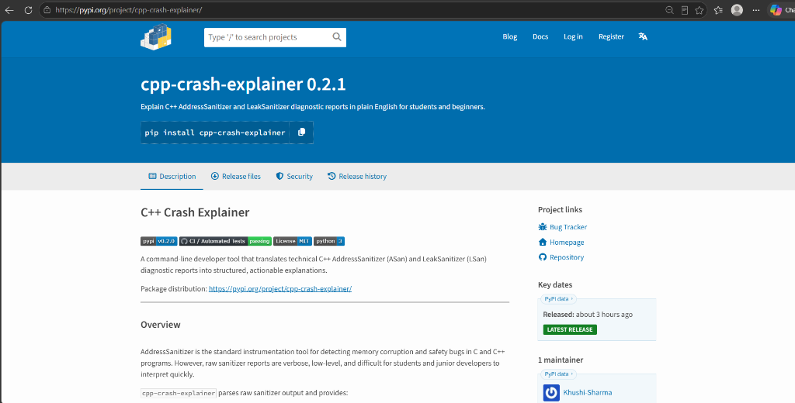
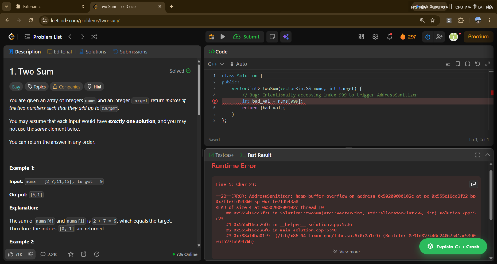
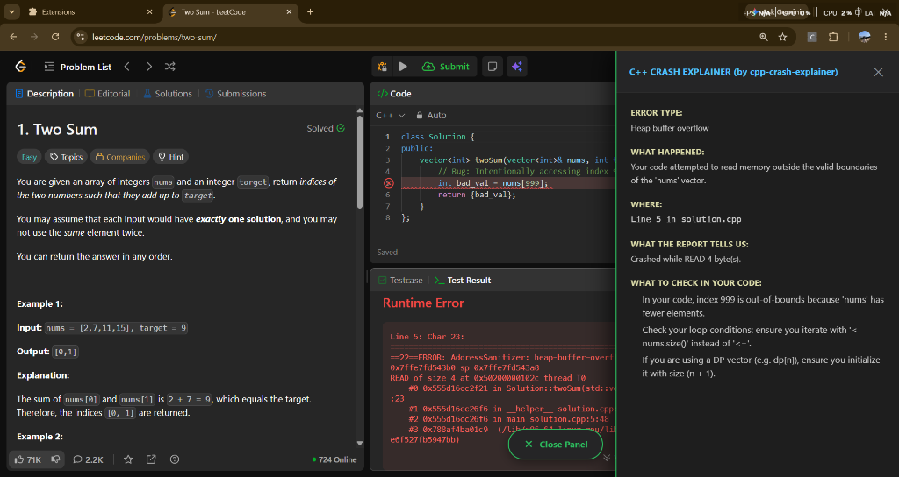
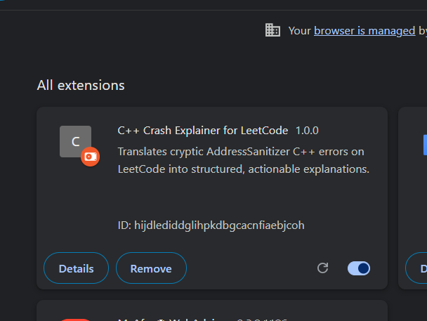
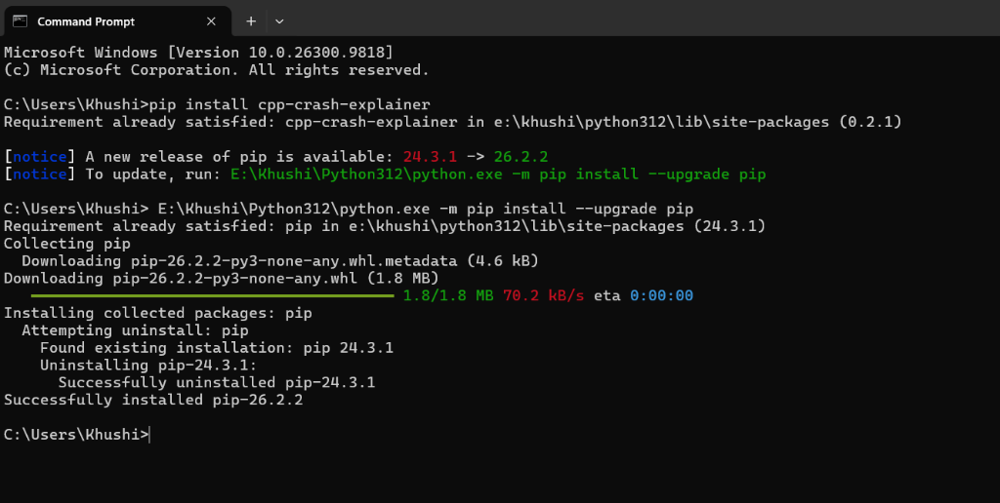

# C++ Crash Explainer

[](https://pypi.org/project/cpp-crash-explainer/)
[](https://github.com/khushi-sharma2506/cpp-crash-explainer/actions)
[](https://opensource.org/licenses/MIT)
[](https://pypi.org/project/cpp-crash-explainer/)

A developer tool and live browser extension that translates technical C++ AddressSanitizer (ASan), UBSan, and runtime diagnostic reports into structured, actionable explanations for students and beginners.

Package distribution: [https://pypi.org/project/cpp-crash-explainer/](https://pypi.org/project/cpp-crash-explainer/)

[](https://pypi.org/project/cpp-crash-explainer/)

Browser extension (LeetCode debugger): Available in [Releases](https://github.com/khushi-sharma2506/cpp-crash-explainer/releases) and under review on [Firefox Add-ons](https://addons.mozilla.org/).

---

## Overview

AddressSanitizer is the standard instrumentation tool for detecting memory corruption and safety bugs in C and C++ programs. However, raw sanitizer reports are verbose, low-level, and difficult for students and junior developers to interpret quickly.

`cpp-crash-explainer` parses raw sanitizer output and provides:
- Accurate error classification based on the report header.
- Exact source code locations (file path, line number, and function name).
- Extracted runtime metrics (access size, buffer dimensions, offset direction, allocation site, deallocation site).
- Concrete debugging steps focused on common root causes (off-by-one errors, pointer scope, missing deallocations).
- Explicit limitations regarding what cannot be derived from the report alone.

The tool does not compile code, execute binaries, or guess causes without report evidence.

---

## Browser Extension for LeetCode (Chrome, Edge, Firefox)

A companion Chrome extension reads LeetCode's C++ runtime error output in real time and displays a plain-English explanation in a slide-out panel — no copy-pasting required.

### Live Demonstration

| 1. Error Detected on LeetCode | 2. Plain-English Diagnosis Drawer |
| :---: | :---: |
|  |  |

### Install (Free, No Store Required)

1. Download or clone this repository
2. Open Chrome and go to `chrome://extensions/`
3. Enable **Developer mode** (toggle in the top-right corner)
4. Click **Load unpacked**
5. Select the `extensions/chrome-leetcode/` folder from this repository



The **Explain C++ Crash** button will appear automatically whenever LeetCode detects a C++ runtime error.

### Errors Explained

| Error | Sanitizer |
|-------|-----------|
| Heap Buffer Overflow | AddressSanitizer |
| Negative Index / Underflow | UBSan |
| Division by Zero | SIGFPE / UBSan |
| Index Out of Range (`.at()`) | std::out_of_range |
| Empty Vector Access | UBSan |
| Null Pointer Dereference | SEGV / UBSan |
| Memory Limit Exceeded | MLE / std::bad_alloc |
| Heap Use-After-Free | AddressSanitizer |

---

## Supported Categories

| Category | Extracted Data | Typical Root Cause |
| :--- | :--- | :--- |
| Heap Buffer Overflow | Access type (`READ`/`WRITE`), byte count, offset, buffer size, allocation site | Out-of-bounds array access, incorrect loop bounds, allocation size mismatch |
| Heap Use-After-Free | Access size, deallocation location, original allocation site, crash location | Accessing dangling pointers, duplicate deletion, premature object cleanup |
| Stack Buffer Overflow | Target stack variable, access size, crash function and line | Exceeding fixed-size local stack array bounds |
| Stack Use-After-Scope | Target scoped variable, frame location | Storing or returning pointers to variables defined in inner blocks |
| Global Buffer Overflow | Global variable name, definition file and line, overflow offset | Out-of-bounds indexing of global or static variables |
| Null Pointer Dereference | Target address (`0x0` / zero page), access operation | Dereferencing uninitialized pointers or unchecked return values |
| Memory Leak | Leaked byte total, allocation count, allocation call site | Failure to release dynamically allocated memory before program exit |

---

## Installation

Install the package directly from [PyPI](https://pypi.org/project/cpp-crash-explainer/):

```bash
pip install cpp-crash-explainer
```



View the official package distribution page on [PyPI: cpp-crash-explainer](https://pypi.org/project/cpp-crash-explainer/).

Requirements: Python 3.8 or higher. Standard library only; no external runtime dependencies.

---

## Usage

### 1. File Input

Pass the path to a saved AddressSanitizer report:

```bash
cpp-crash-explainer report.txt
```

### 2. Standard Input (Piping)

Pipe the output of a sanitized binary directly:

```bash
./my_program 2>&1 | cpp-crash-explainer
```

### 3. Command-Line Options

```text
usage: cpp-crash-explainer [-h] [--no-color] [report_file]

Explain C++ AddressSanitizer diagnostic reports in plain English.

positional arguments:
  report_file  Path to the file containing the AddressSanitizer report (reads stdin if omitted).

options:
  -h, --help   show this help message and exit
  --no-color   Disable ANSI colorized output.
```

---

## Example Output

Given a standard AddressSanitizer report for an out-of-bounds heap read, `cpp-crash-explainer` produces:

```text
C++ CRASH EXPLAINER

ERROR TYPE
Heap buffer overflow

WHAT HAPPENED
The program attempted to read or write memory outside the valid boundaries of a dynamically allocated (heap) array or object.

WHERE
/home/student/projects/buffer_test.cpp:14 (in function 'main')

WHAT THE REPORT TELLS US
The program crashed while reading 4 byte(s). The memory access occurred 4 byte(s) past the end of a 40-byte allocated heap buffer. The heap buffer was allocated at /home/student/projects/buffer_test.cpp:10.

WHAT TO CHECK NEXT
1. Check the array/buffer indexing at the crash location to see if the index exceeds the size.
2. Remember that in C++, an array of size N has valid indices from 0 to N-1 (off-by-one errors are common).
3. Check loop bounds (e.g., using '<=' instead of '<').
4. If using raw pointers or manual allocation (new[] / malloc), verify that the allocated byte size matches the data type.

LIMITATIONS
AddressSanitizer detects that an out-of-bounds address was accessed, but it cannot know what value you intended to calculate or why the index became invalid. Inspect the logic leading up to the access.
```

---

## Development and Testing

Clone the repository and install development tools:

```bash
git clone https://github.com/khushi-sharma2506/cpp-crash-explainer.git
cd cpp-crash-explainer
pip install -e .
pip install pytest
```

Run the automated test suite:

```bash
pytest
```

---

---

## Publishing and Releases

Releases to the Python Package Index (PyPI) are automated through GitHub Actions using OpenID Connect (OIDC) Trusted Publishing. Creating a published release on GitHub triggers the build, verification test matrix across Linux, Windows, and macOS, and uploads the distribution packages directly to PyPI.

---

## License

This project is licensed under the MIT License. See the [LICENSE](LICENSE) file for details.

---

**Developed by Khushi Sharma**
